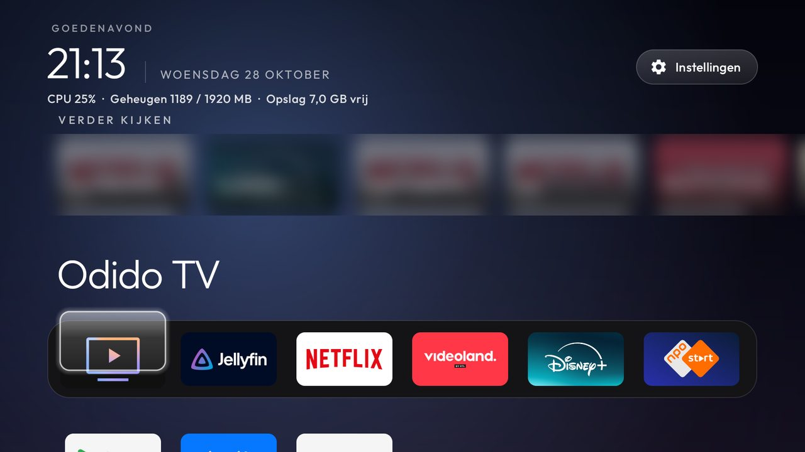

# gwiersma/cleanyourtv: a Continue watching row

A fork of [Gathin23/cleanyourtv](https://github.com/Gathin23/cleanyourtv) whose launcher adds one thing: a
**Continue watching** row between the clock and the dock, read from Android TV's own Watch Next table.

**Built and tested on:** Strong LEAP-S3 (SkyworthDigital YDA, Amlogic S905Y4, Google TV 14,
`UKG3.260128.001.C3.0.12`). Disney+, Videoland, Jellyfin and Netflix published rows there; YouTube publishes none.

## What it changes

- `ContinueWatching.java` reads `TvContract.WatchNextPrograms` once each time Home comes back (no timer, no
  service) and keeps browsable rows engaged in the last 60 days, drops "continue" rows past 95 %, shows one card
  per show and ten at most, newest first.
- `ContinueRow.java` draws the cards: poster or app banner, title, `S2 · E5 · episode`, and a progress bar.
  It owns its focus the way the library button does: Up from the dock enters it, Up again goes to the top bar,
  Down returns to the dock, Left/Right stop at its ends. It is only on screen while focus is in the top bar,
  the row or the dock, so it never meets the grid when that scrolls up.
- **Still no `INTERNET` permission.** Rows whose poster is an `https://` address get the app's own banner, a
  local resource. Local posters (Jellyfin's `content://` provider) are drawn, but each can take seconds because
  the provider fetches it from the Jellyfin server, so the row comes up at once and swaps posters in one by one,
  with a small cache across Home resumes.
- A row's `intent_uri` is only followed when it points at the app that published the row; anything else opens
  that app's launch intent.
- One new permission, `READ_TV_LISTINGS`, granted by `launcher/build-and-install.sh` (`pm grant`). Without it
  the query fails and the row stays hidden.
- The switch is `continue_watching` in `config.xml`, off in the feature commit
  ([575f567](https://github.com/gwiersma/cleanyourtv/commit/575f5671)); the next commit is this fork's own box
  config. Notes on the table itself are in [`docs/watch-next.md`](docs/watch-next.md#in-the-launcher).

## Building

As upstream: `TV_HOST=<tv ip> launcher/build-and-install.sh`. The Python suite passes on the feature commit;
`tests/test_sky_place_note.py` fails on the box-config commit by design, because that config sets the Sky's
latitude and longitude.
